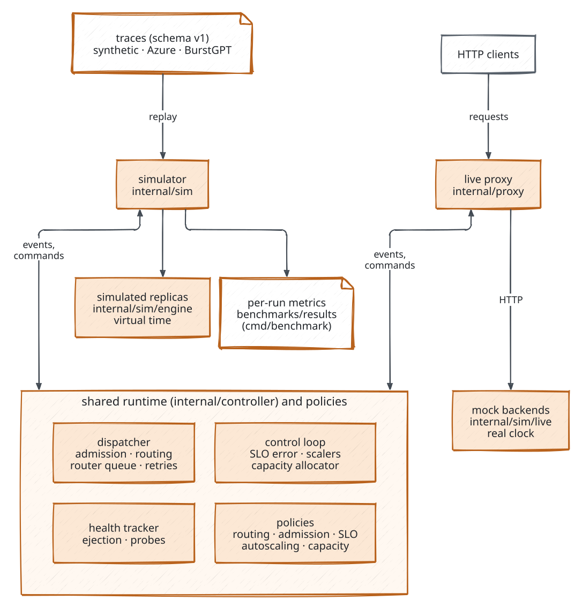
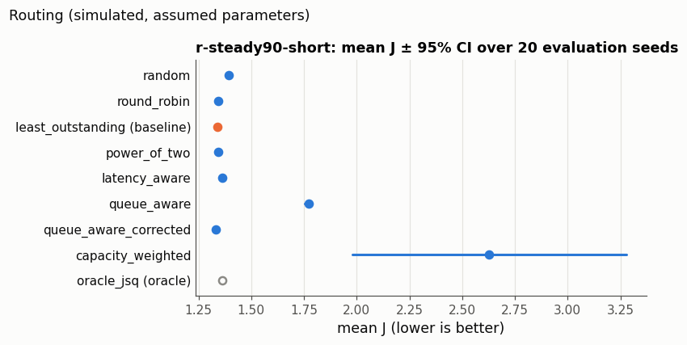
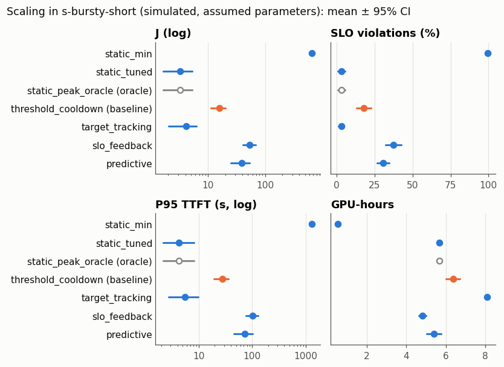

<p align="center"></p>

<p align="center">
<a href="https://github.com/AKASB1/llm-serving-control/actions/workflows/ci.yml"></a>
<a href="LICENSE"></a>


</p>

# LLM Serving Control Plane

`llm-serving-control` is a Go control plane for multi-model LLM serving: request routing, replica health tracking, autoscaling, capacity allocation under a GPU budget, SLO control, and admission control. Its policies run unchanged in a deterministic discrete-event simulator and in a live proxy in front of mock backends.

<p align="center"><a href="#overview">Overview</a> · <a href="#highlights">Highlights</a> · <a href="#how-it-works">How it works</a> · <a href="#getting-started">Getting started</a> · <a href="#results">Results</a> · <a href="#documentation">Documentation</a> · <a href="#limitations">Limitations</a></p>

> **Simulated results.** All results except the decision-cost microbenchmarks come from the simulator, which uses assumed hardware parameters ([docs/simulator.md](docs/simulator.md)).

## Overview

The project compares control policies for LLM serving on identical traffic: which router, scaler, capacity allocator, and admission policy keep tail latency, GPU cost, and SLO violations lowest. The control plane decides where each request goes and how many replicas each model gets; token generation stays in the serving backend.

The dispatcher, the health tracker, the control loop, and every policy are plain Go objects driven by explicit times, so the simulator and the live proxy call the same code. In the simulator every policy sees the same replayed traffic, and a rerun on the same commit produces byte-identical result files (tested in `cmd/benchmark`).

<p align="center"></p>

## Highlights

Means over 20 evaluation seeds; lower J is better ([tables](docs/figures/results_table.md)). J, defined under [Results](#results), is a weighted sum of P95 TTFT, P95 TPOT, GPU-hours relative to the budget, and the violation rate. Oracle policies use information a real system does not have; the other policies are deployable.

- **Admission control under overload.** At 130 % load for five minutes (`o-overload`), `queue_cap` and `predicted_ttft_shed` cut mean J from 32.261 (`none`) to 2.435 and 2.361. The violation rate, rejections included, falls from 60 % to 14–16 %.
- **Stale load data causes herding.** `queue_aware` ranks replicas by the last scraped queue depth. Between two scrapes it sends every request to the replica that looked emptiest, and it loses to `least_outstanding` in all eight routing scenarios. Counting its own dispatches since the last scrape (`queue_aware_corrected`) removes the herding: it becomes the best non-oracle router in six of the eight, by less than 2 % in J.
- **Load-blind routing fails on mixed GPUs.** With H100, A100, and V100 replicas in one pool (`r-hetero`), `random` and `round_robin` overload the V100s. Their mean J is 126.6, compared with 2.190 for `least_outstanding` and 1.658 for `latency_aware`.
- **A tuned static fleet beats most autoscalers on this objective**, because J charges tail latency far more than GPU cost. `static_tuned` has the lowest mean J among deployable scalers in three of the four scaling scenarios; in `s-bursty-short` it reaches 3.257, compared with 15.713 for `threshold_cooldown`. Its lead is not significant over `threshold_cooldown` in `s-diurnal-long` or over `target_tracking` in `s-bursty-short` (paired ΔJ −0.85 ± 0.92).
- **Marginal-gain allocation under one GPU budget.** With three models (`c-3model`), `marginal_gain` reaches mean J 1.687, compared with 5.072 for `proportional_demand` and 7.311 for `static_partition`.
- **Prefix affinity with shared prompts.** In `p-prefix`, `prefix_affinity` reaches mean J 1.352, compared with 1.444 for `least_outstanding` ([table](docs/figures/prefix/results_table.md)).

## How it works

The modules, the control loop, and the failure handling are described in [docs/architecture.md](docs/architecture.md).

### Shared policy code

The dispatcher (admission, routing, router queue, retries), the health tracker, the control loop (signals, SLO error, scalers, capacity allocator), and every policy take time as an argument. The simulator calls them at virtual times; the live proxy calls them at wall-clock times. One factory builds every policy from `{"name", "params"}` JSON for both paths.

### Simulator

On each replica the simulator runs iteration-level continuous batching with chunked prefill and a KV-cache budget with preemption by recompute. Across the fleet it models the replica lifecycle (provisioning, loading, ready, draining), stale scraped snapshots, crashes, and GPU-hour accounting. The five replica classes are derived from GPU datasheet numbers with stated efficiency factors. Invariant tests and a Pollaczek–Khinchine closed-form check (one replica, batch size one) test the model. See [docs/simulator.md](docs/simulator.md).

### Policies

- Routing: `random`, `round_robin`, `least_outstanding`, `power_of_two`, `latency_aware`, `queue_aware`, `queue_aware_corrected`, `capacity_weighted`, `prefix_affinity`, and the reference `oracle_jsq`.
- Health: passive ejection after consecutive errors, with doubling backoff and probation; active probes; retries only before the first token.
- Scaling: `static`, `threshold_cooldown`, `target_tracking`, `slo_feedback`, `predictive`; scale-in drains replicas before removing them.
- Capacity allocation: `static_partition`, `proportional_demand`, `marginal_gain`.
- Admission: `none`, `queue_cap`, `predicted_ttft_shed`.
- SLO control: per-class TTFT/TPOT/E2E targets and a sliding-window P95 error per model and replica, which feeds scaling, allocation, and routing weights.

Policy semantics are specified in [docs/contracts.md](docs/contracts.md).

### Live proxy

An OpenAI-compatible proxy (`/v1/chat/completions`, `/v1/completions`) runs on the same dispatcher. It passes server-sent events through, retries only before the first byte, cancels the upstream request when the client disconnects, returns `429` with `Retry-After`, and exposes Prometheus `/metrics` and admin endpoints. A mock backend runs the simulator's engine in real time; a process executor starts and stops mock backends for scale-out. See [deploy/README.md](deploy/README.md).

### Traces and backend adapters

Trace schema v1 comes with generators (Poisson, bursty, diurnal, piecewise) and converters for the Azure LLM inference trace 2023 and BurstGPT. The [vLLM](https://github.com/vllm-project/vllm) and [SGLang](https://github.com/sgl-project/sglang) metric mappings are tested against fixtures written from those projects' sources. See [docs/contracts.md](docs/contracts.md).

## Getting started

### Prerequisites

Go 1.23 or later (see `go.mod`); Python 3 with matplotlib, only to redraw the figures. The commands are the same in Windows PowerShell and in bash on Linux or macOS; run them from the repository root. On Linux and macOS, run the shell scripts with `bash` as shown, or run `chmod +x scripts/*.sh` once: the repository does not keep executable bits.

### Building

```bash
go build ./...
```

### Running

Run a quick subset of the benchmark, route one request in-process, or write a synthetic trace:

```bash
go run ./cmd/benchmark -quick
go run ./cmd/control-plane -config configs/example.json -once
go run ./cmd/tracegen -config configs/traces/sample.gen.json -seed 1 -out outputs/traces/sample.csv
```

The quick subset (three scenarios at a quarter of their duration) takes a few seconds and writes its results to `outputs/quick/`.

To try the live proxy, run the demo. It builds the binaries, starts two mock backends and the control plane on 127.0.0.1:18080/18100/18101, and streams a request. Then it kills a backend, triggers a scale-out, and shuts everything down, in about a minute in total. Linux, macOS, or Git Bash:

```bash
bash scripts/demo.sh
```

Windows PowerShell:

```powershell
powershell -ExecutionPolicy Bypass -File scripts\demo.ps1
```

## Running the tests

```bash
go vet ./...
go test ./...
go test -race ./...
go test -run NONE -bench . -benchmem ./internal/routing ./internal/controller
```

`go test -race` needs cgo and a C compiler. The last command runs the decision-cost microbenchmarks ([benchmarks/README.md](benchmarks/README.md#decision-cost)). CI (`.github/workflows/ci.yml`) runs build, vet, gofmt, `go test -race ./...`, and the quick benchmark on Linux.

## Results

One scenario per family; mean J over 20 evaluation seeds in the simulator (lower is better). For routing, the table shows `r-hetero`, the only routing scenario in which a deployable router beats the baseline by more than 2 %; `latency_aware` is best there but worse than `least_outstanding` in the other seven routing scenarios. Scaling shows bursty short-heavy traffic; capacity and overload have one scenario each.

| family | scenario | baseline (mean J) | best deployable policy (mean J) |
|---|---|---|---|
| routing | `r-hetero` | `least_outstanding` 2.190 | `latency_aware` 1.658 |
| scaling | `s-bursty-short` | `threshold_cooldown` 15.713 | `static_tuned` 3.257 |
| capacity | `c-3model` | `static_partition` 7.311 | `marginal_gain` 1.687 |
| overload | `o-overload` | `none` 32.261 | `predicted_ttft_shed` 2.361 |

`J = P95(TTFT)/2 s + P95(TPOT)/100 ms + GPU-hours/(budget·duration) + 5·violation rate` for interactive traffic (batch: 20 s / 250 ms); rejected, failed, timed-out, and unfinished requests count as violations. Mean J and verdicts for every scenario: [benchmarks/README.md](benchmarks/README.md#results); per-metric columns, intervals, and win/tie/loss counts: [docs/figures/results_table.md](docs/figures/results_table.md).



*Routing in `r-steady90-short` (Poisson arrivals at 90 % load, short-heavy requests). This is the typical case: in every routing scenario except `r-hetero`, no deployable router beats the baseline by more than 2 %. All eight scenarios are in [benchmarks/README.md](benchmarks/README.md#results).*



*Scaling in `s-bursty-short`, the scaling scenario of the table above: bursty short-heavy traffic, in which the tuned static fleet beats the baseline `threshold_cooldown` (3.257 against 15.713). All four scaling scenarios and the capacity, overload, and sensitivity figures are in [benchmarks/README.md](benchmarks/README.md#results).*

Key assumed parameters ([docs/simulator.md](docs/simulator.md)):

| Assumption | Value |
|---|---|
| Replica classes | datasheet numbers of H100 SXM5 80GB, A100 SXM4 80GB, and V100 SXM2 32GB, with assumed `eff_mem_bw` 0.7 and `eff_flops` 0.5; `tp_efficiency` 0.85 for 4-GPU tensor parallel |
| Iteration time | a linear model of memory and compute time, not fitted to any measurement |
| Engine limits | `max_num_seqs` 128, `max_batched_tokens` 2048 tokens, `max_model_len` 16384 tokens |
| Provisioning and loading delay | provisioning 30 s (every class); loading 60 s (8B), 75 s (8B on V100), 150 s (70B) |
| Scrape interval, control step | 1 s, 5 s |
| Network, routers | zero network latency, one router |

Two excerpts of the Azure LLM inference trace 2023 and a 600 s window of BurstGPT were also replayed against one simulated A100 and one simulated V100 replica. Results: [Azure table](docs/figures/replay/results_table.md), [BurstGPT table](docs/figures/replay-burstgpt/results_table.md). The traffic is real; the backend is simulated. The BurstGPT window, mostly `GPT-4` API calls with very short outputs, is not representative of the whole trace ([window statistics](docs/figures/replay-burstgpt/trace_stats.md)).

The main rankings were recomputed under seven weight vectors of J (the reference weights and six others) from the committed per-run metrics, without re-tuning ([reweighting table](docs/figures/reweight/results_table.md)).

## Evaluation protocol

- The objective J and its weights were fixed before any run and are the same for every policy.
- Tuning uses seeds 101–105 with an equal random-search budget (12 configurations per policy); the tuned configurations were committed before the evaluation.
- The evaluation uses seeds 1–20; the sensitivity variants use seeds 1–10 and change one assumption at a time.
- Means come with two-sided 95 % Student-t intervals; each policy is compared with its family baseline by paired differences of J, with win/tie/loss counts at a 1 % tie band.
- The oracles (`oracle_jsq`, `static_peak_oracle`) are reference policies: they are not deployable, and their J is not a lower bound for the other policies.

Commands, scenarios, and run times: [benchmarks/README.md](benchmarks/README.md#reproduce).

## Project layout

```text
cmd/benchmark/        tuning, evaluation, statistics, result files
cmd/control-plane/    live proxy (control-plane binary); -once routes one request in-process
cmd/mock-backend/     mock replica process
cmd/tracegen/         synthetic trace generator
cmd/traceconv/        public-trace converter (Azure 2023, BurstGPT)
internal/
  adapters/           Prometheus text parser, vLLM and SGLang mappings, scraper
  admission/          admission policies
  autoscaling/        scalers
  backends/           Backend and Scraper interfaces
  capacity/           allocators
  clock/ rng/         injected time, per-component random streams
  controller/         dispatcher, health, control loop, policy factory
  executor/           executor interface, process executor
  metrics/            snapshots, windows, records, run summary
  proxy/              live proxy (HTTP)
  registry/           replicas and classes
  routing/            routing policies
  sim/ sim/engine/    discrete-event simulator and replica engine
  sim/live/           mock backend (engine in real time)
  slo/                targets, attainment, SLO controller
  store/              replica persistence (memory, JSON file)
  trace/              trace schema v1 and converters
loadgen/              workload generators
configs/              classes, experiments, tuned configurations, traces
benchmarks/           protocol and committed results
docs/                 architecture, contracts, simulator, figures, diagram source, icon
deploy/               deployment notes
scripts/              figure, table, diagram, and icon scripts; live demo
```

## Documentation

- [docs/architecture.md](docs/architecture.md): modules, control loop, data flow, shared policy code, failure handling, determinism
- [docs/contracts.md](docs/contracts.md): trace schema v1, metric definitions, policy semantics, HTTP surface
- [docs/simulator.md](docs/simulator.md): the simulator model, every assumption, class derivation, calibration protocol (not executed)
- [benchmarks/README.md](benchmarks/README.md): protocol, scenarios, full results, replays, reweighting, decision cost
- [deploy/README.md](deploy/README.md): what runs locally and what is planned
- [configs/traces/README.md](configs/traces/README.md): committed trace excerpts and their attribution
- [IMPLEMENTATION.md](IMPLEMENTATION.md): design notes and the implementation checklist
- [CONTRIBUTING.md](CONTRIBUTING.md): the checks to run and how results are regenerated

## Limitations

- The [simulator](docs/simulator.md) is uncalibrated: replica performance comes from datasheets and assumed efficiency factors.
- No real GPU, vLLM, or SGLang server was used; the live proxy has run only against mock backends.
- Eight routing, four scaling, one capacity, and one overload scenario; 20 evaluation and 5 tuning seeds.
- Not built: Kubernetes executor, gRPC admin API, PostgreSQL and Redis stores, OpenTelemetry tracing.

Further limitations: [benchmarks/README.md](benchmarks/README.md#limitations).

## Related projects

- [vllm-project/production-stack](https://github.com/vllm-project/production-stack): a Kubernetes-native reference stack for deploying vLLM across a cluster, with a request router, Helm charts, and dashboards. This project focuses on the control policies and compares them in a simulator.
- [microsoft/vidur](https://github.com/microsoft/vidur): a simulator of LLM inference systems with execution times from profiled models. This project derives replica performance from datasheet numbers and uses its simulator to compare routing, scaling, allocation, and admission policies.
- [llm-d/llm-d](https://github.com/llm-d/llm-d): Kubernetes-native distributed inference with prefix- and KV-aware scheduling and disaggregated serving. Here, prefix-aware routing (`prefix_affinity`) is one of the policies compared in the simulator.
- [ai-dynamo/dynamo](https://github.com/ai-dynamo/dynamo): a datacenter-scale inference serving framework with KV-aware routing and planner-based autoscaling. This project is a single-router control plane whose scalers are compared in simulation.

## License

MIT, see [LICENSE](LICENSE). The trace excerpts in `configs/traces/` are derived from the Azure LLM inference trace 2023 and BurstGPT, both under CC BY 4.0; attribution and the list of changes are in [configs/traces/README.md](configs/traces/README.md).
