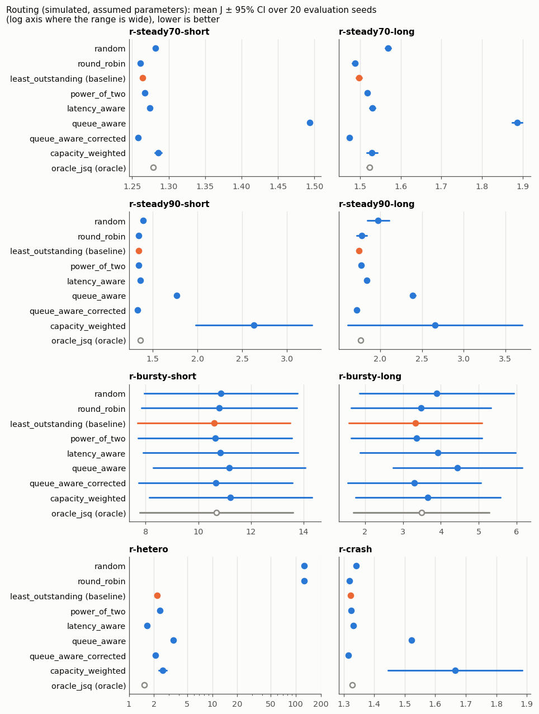
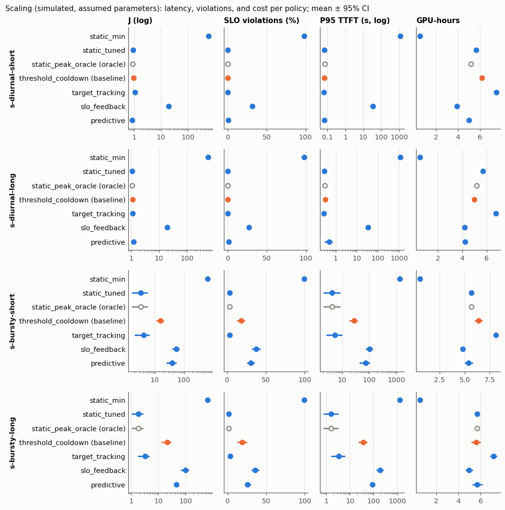
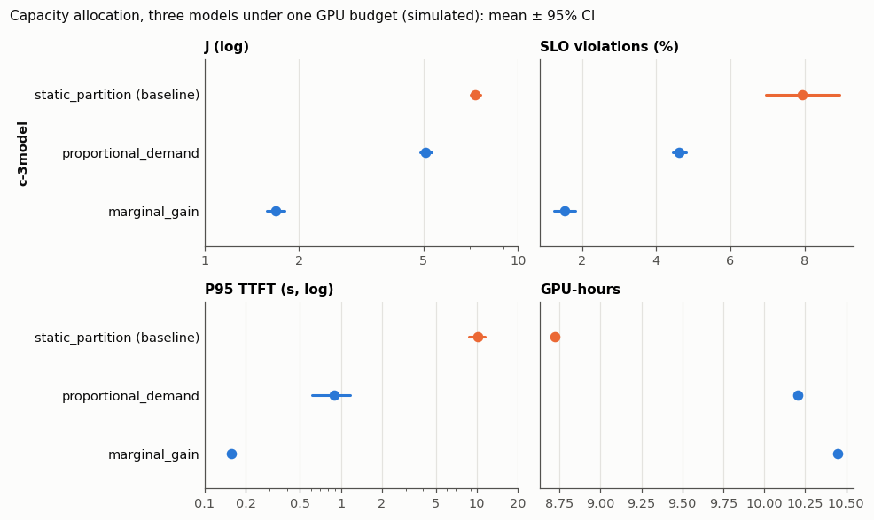
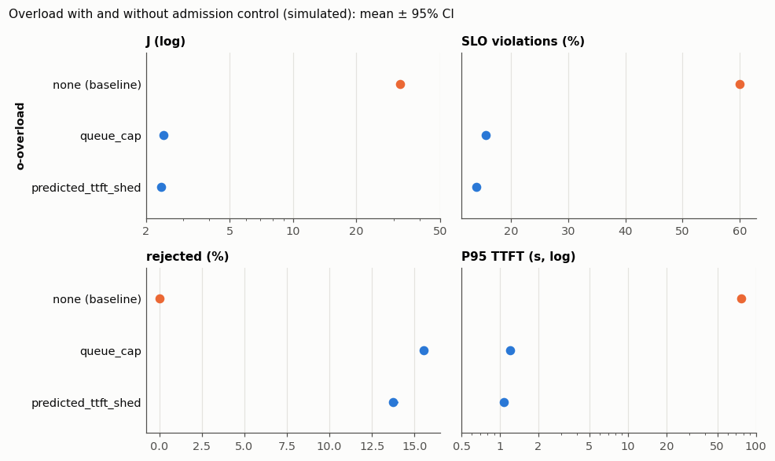
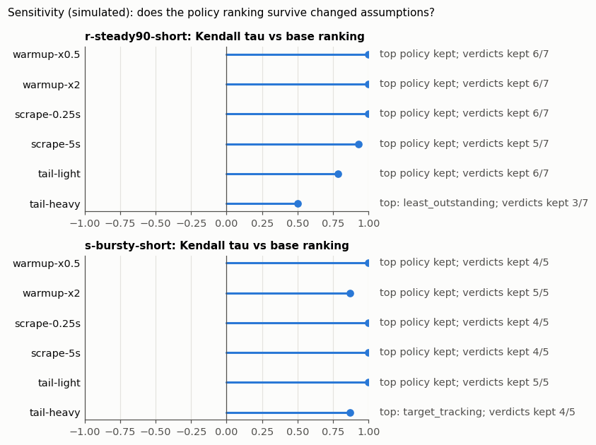

# Benchmarks

The benchmark compares control-plane policies on identical replayed traffic against simulated replicas with assumed parameters ([docs/simulator.md](../docs/simulator.md)). Two kinds of numbers here are not simulated. The traffic statistics of the replayed trace excerpts (request and token counts, timestamps) describe the real traces. The decision-cost microbenchmarks measure the real CPU time of the policy code.

## Reproduce

```bash
go run ./cmd/benchmark -tune
go run ./cmd/benchmark
python scripts/plot_results.py
```

1. `-tune` runs every parametrized policy on the **tuning seeds** (101–105) with the same random-search budget: 12 configurations, search seed 20261001, configuration 0 being the policy's defaults. It writes `configs/tuned/tuned.json` and `configs/tuned/tuning_log.csv`. These files are committed **before** the evaluation; the evaluation never re-tunes. (14 min 18 s on an x86-64 desktop CPU with 32 logical CPUs; wall-clock times are indicative only.)
2. The evaluation runs every policy of every family on the **evaluation seeds** (1–20) plus the sensitivity variants (seeds 1–10). It writes one row per run to `results/runs.csv` and the aggregates beside it. (14 min 19 s and 9 min 59 s in two runs on the same machine; the second run, on the final commit, produced the committed files.)
3. The plotting script reads only the committed result files and writes `docs/figures/*.png` and `docs/figures/results_table.md`.

`go run ./cmd/benchmark -quick` runs a smoke subset into `outputs/quick/` in a few seconds. It covers three scenarios at a quarter of their duration and seeds 1–3, including a replay of the committed sample trace `configs/traces/sample.csv`. CI runs it on every push.

Traces are generated from the committed generator configuration into `outputs/traces/` (ignored by git) and replayed from those files; each run row records the trace's SHA-256 prefix. The manifest (`results/manifest.json`) records the commit, the SHA-256 of the configuration files (experiment, classes, tuned configuration, sample trace), the commit the tuning ran on, and the seeds. It also records the Go version, the platform, the hardware, and the measured per-replica capacities. The hardware is detected unless `-hardware` is given; the committed manifests name a hardware class. The commit IDs in the manifests and in the generated table headers refer to the development history of this project, which is not published. The published history starts with the synchronized implementation. Result files contain no timestamps, so a rerun on the same commit is byte-identical (tested in `cmd/benchmark`).

## Protocol (fixed before the first evaluation run)

**Objective.** `J = 1·P95(TTFT)/T_ttft + 1·P95(TPOT)/T_tpot + 1·GPU-hours/(GPU budget·run hours) + 5·violation rate` (definitions in [docs/contracts.md](../docs/contracts.md) §3). Targets: `interactive` TTFT 2 s, TPOT 100 ms; `batch` TTFT 20 s, TPOT 250 ms. Lower J is better. The weights were set before any run and are the same for every policy.

**Seeds.** Tuning {101…105}; evaluation {1…20}; sensitivity {1…10} (a subset of the evaluation seeds, never used for tuning).

**One dimension at a time.** Routing scenarios fix the scaler (static at the initial count). Scaling scenarios fix the router: the default chosen on the tuning seeds, which is the non-oracle router with the lowest tuning J. Allocation fixes both: the router as above and the adaptive scaler with the lowest tuning J. Overload fixes the router and a static scaler.

**Statistics.** Mean and two-sided 95 % Student-t interval over seeds. Paired difference in J against the family baseline on common seeds with its t-interval; verdict "better"/"worse" only when that interval excludes zero, otherwise "no difference". Per-seed wins/ties/losses with a tie band of 1 % of the baseline's J. Baselines: routing `least_outstanding`, scaling `threshold_cooldown` (the baseline named in the original project plan), allocation `static_partition`, overload `none`.

**Capacity reference.** Arrival rates are fractions of each class's saturation throughput under each length mix. A probe in the simulator measures that throughput (one replica, every request queued at once, completions counted from 120 s to 600 s), and the manifest records it.

**Length mixes.** Short-heavy: prompt lognormal (median 256, σ 1.0, 8–4096), output lognormal (median 128, σ 1.2, 1–2048). Long-heavy: prompt lognormal (median 2048, σ 0.7, 128–12288), output lognormal (median 256, σ 1.2, 1–4096). Prompt + output ≤ 16384.

## Scenarios

| ID | Family | Replicas | Traffic | Duration |
|---|---|---|---|---|
| r-steady70-short / -long | routing | 4 × h100-8b, static | Poisson at 70 % of capacity | 600 s |
| r-steady90-short / -long | routing | 4 × h100-8b | Poisson at 90 % | 600 s |
| r-bursty-short / -long | routing | 4 × h100-8b | MMPP on/off (2.0× for ~15 s, 0.5× for ~30 s), mean 70 % | 600 s |
| r-hetero | routing | 2 × h100-8b, 2 × a100-8b, 2 × v100-8b | Poisson at 80 % of the summed capacity | 600 s |
| r-crash | routing | 4 × h100-8b | Poisson 70 %; replica `h100-8b-001` crashes at 300 s | 600 s |
| s-diurnal-short / -long | scaling | h100-8b, 5 at start, 1–16 | diurnal (thinning), amplitude 0.8, period 1800 s, mean 70 % of 6 replicas | 1800 s |
| s-bursty-short / -long | scaling | same | MMPP with state rates 2.03× (mean sojourn 120 s) and 0.49× (240 s) the mean (configured multipliers 2.5 and 0.6, renormalized to mean 1), mean 70 % of 6 replicas | 1800 s |
| c-3model | capacity | chat-8b (h100-8b), code-8b (h100-8b-code), chat-70b (4 × H100); budget 20 GPUs, below the sum of the peaks | diurnal per model, phases shifted by a third of a period | 1800 s |
| o-overload | overload | 4 × h100-8b, static | 60 % → 130 % (300–600 s) → 60 %; 70 % interactive, 30 % batch | 900 s |

All runs add a 60 s drain horizon; requests unfinished by then are violations.

**Policies.** Routing: `random`, `round_robin`, `least_outstanding`, `power_of_two`, `latency_aware`, `queue_aware`, `queue_aware_corrected`, `capacity_weighted`, `oracle_jsq` (oracle). Scaling: `static_min` (1 replica), `static_tuned` (count chosen on the tuning seeds), `static_peak_oracle` (peak rate known in hindsight, sized at 80 % utilization), `threshold_cooldown`, `target_tracking`, `slo_feedback`, `predictive`. `static_peak_oracle` is an oracle reference, not a bound: `predictive` beats it on s-diurnal-short. Allocation: `static_partition`, `proportional_demand`, `marginal_gain`. Admission: `none`, `queue_cap`, `predicted_ttft_shed`.

**Sensitivity.** On `r-steady90-short` and `s-bursty-short`: warm-up ×0.5 and ×2, scrape interval 0.25 s and 5 s, and a lighter (σ 0.8) and a heavier (σ 1.6) output tail. The tails keep the absolute arrival rate, so the heavier tail is also more load. Reported: Kendall τ between the base and variant rankings of non-oracle policies by mean J, whether the top policy stays on top, and how many baseline verdicts stay the same.

## Results

Condensed (mean J and verdict against the family baseline); every metric with its interval and win/tie/loss counts: [docs/figures/results_table.md](../docs/figures/results_table.md). Raw rows: `results/runs.csv`; aggregates: `results/aggregates.csv`; paired comparisons: `results/paired.csv`; sensitivity: `results/sensitivity.csv`; provenance: `results/manifest.json`.

<!-- results-summary:start -->
<!-- generated by scripts/plot_results.py from benchmarks/results; do not edit by hand -->
Mean J over 20 evaluation seeds (lower is better). ✓ / ✗ / = : better / worse / no difference than the family baseline (paired 95% interval of ΔJ). Oracles are references, not deployable. Simulated, assumed parameters.

**routing** (baseline `least_outstanding`)

| policy | r-steady70-short | r-steady70-long | r-steady90-short | r-steady90-long | r-bursty-short | r-bursty-long | r-hetero | r-crash |
|---|---|---|---|---|---|---|---|---|
| random | 1.282 ✗ | 1.569 ✗ | 1.393 ✗ | 1.974 ✗ | 10.863 ✗ | 3.889 ✗ | 126.6 ✗ | 1.340 ✗ |
| round_robin | 1.261 ✓ | 1.488 ✓ | 1.343 ✗ | 1.781 = | 10.790 ✗ | 3.478 ✗ | 126.6 ✗ | 1.320 ✓ |
| least_outstanding (baseline) | 1.264 | 1.497 | 1.341 | 1.745 | 10.600 | 3.329 | 2.190 | 1.323 |
| power_of_two | 1.267 ✗ | 1.518 ✗ | 1.345 ✗ | 1.770 ✗ | 10.638 = | 3.362 = | 2.365 ✗ | 1.325 ✗ |
| latency_aware | 1.274 ✗ | 1.531 ✗ | 1.364 ✗ | 1.840 ✗ | 10.843 ✗ | 3.923 ✗ | 1.658 ✓ | 1.332 ✗ |
| queue_aware | 1.494 ✗ | 1.886 ✗ | 1.771 ✗ | 2.391 ✗ | 11.182 ✗ | 4.436 ✗ | 3.430 ✗ | 1.522 ✗ |
| queue_aware_corrected | 1.258 ✓ | 1.475 ✓ | 1.334 ✓ | 1.720 ✓ | 10.659 ✗ | 3.295 = | 2.092 ✓ | 1.316 ✓ |
| capacity_weighted | 1.286 ✗ | 1.529 ✗ | 2.629 ✗ | 2.654 = | 11.230 ✗ | 3.658 ✗ | 2.561 ✗ | 1.664 ✗ |
| oracle_jsq (oracle) | 1.279 ✗ | 1.523 ✗ | 1.362 ✗ | 1.762 ✗ | 10.696 ✗ | 3.485 ✗ | 1.529 ✓ | 1.329 ✗ |

**scaling** (baseline `threshold_cooldown`)

| policy | s-diurnal-short | s-diurnal-long | s-bursty-short | s-bursty-long |
|---|---|---|---|---|
| static_min | 580.1 ✗ | 576.2 ✗ | 654.9 ✗ | 642.0 ✗ |
| static_tuned | 0.922 ✓ | 1.097 = | 3.257 ✓ | 1.905 ✓ |
| static_peak_oracle (oracle) | 0.878 ✓ | 1.080 ✓ | 3.257 ✓ | 1.905 ✓ |
| threshold_cooldown (baseline) | 0.967 | 1.106 | 15.713 | 20.867 |
| target_tracking | 1.099 ✗ | 1.144 ✗ | 4.111 ✓ | 3.243 ✓ |
| slo_feedback | 19.371 ✗ | 19.440 ✗ | 54.123 ✗ | 98.565 ✗ |
| predictive | 0.836 ✓ | 1.211 = | 39.224 ✗ | 46.621 ✗ |

**capacity** (baseline `static_partition`)

| policy | c-3model |
|---|---|
| static_partition (baseline) | 7.311 |
| proportional_demand | 5.072 ✓ |
| marginal_gain | 1.687 ✓ |

**overload** (baseline `none`)

| policy | o-overload |
|---|---|
| none (baseline) | 32.261 |
| queue_cap | 2.435 ✓ |
| predicted_ttft_shed | 2.361 ✓ |
<!-- results-summary:end -->











What the numbers say:

- Routing on identical replicas barely matters below saturation, and stale signals hurt. At 70–90 % load `least_outstanding`, `power_of_two`, `latency_aware`, `queue_aware_corrected`, and the oracle are within 2–7 % of each other in J. J includes the GPU term, a constant 1.0 for a static fleet, so latency differences look smaller in J than they are. `capacity_weighted` is unstable at 90 % load: J is +97 % and +52 % over the baseline. In `r-steady90-long` it loses on 18 of 20 seeds, and the "=" verdict there comes from two outlier seeds that widen the interval. `queue_aware`, which sees only scraped snapshots, herds requests onto the replica that looked emptiest and loses in all eight routing scenarios. Adding router-local dispatches since the last scrape (`queue_aware_corrected`) removes the herding. It then becomes the best non-oracle router in six of eight scenarios, though by small margins (under 2 % in J). Some "better" verdicts are statistically clear but tiny: all 20 per-seed differences fall inside the 1 % tie band (see W/T/L in the full table).
- Heterogeneous replicas punish load-blind routing. With H100, A100, and V100 replicas, `random` and `round_robin` overload the slow V100s (J ≈ 127 against 2.19 for `least_outstanding`); `latency_aware` is the best deployable router there (1.66).
- Routing cannot create capacity. In `r-bursty-short` bursts reach about 140 % of capacity and every router ends with P95 TTFT around 15 s.
- The oracle is not a bound on J. `oracle_jsq` balances true remaining work, which ignores the batch composition that drives TPOT; it wins only on the heterogeneous cluster.
- A well-chosen static fleet beats most autoscalers on this objective. The static count tuned on the tuning seeds (11 replicas) has the lowest mean J among deployable scalers in three of four scaling scenarios. The reason is that J charges tail latency far more than GPU cost. Its lead is not significant over `threshold_cooldown` in `s-diurnal-long` or over `target_tracking` in `s-bursty-short` (paired ΔJ −0.85 ± 0.92). `predictive` wins on the smooth diurnal short-heavy trace with less GPU time, but loses badly on bursts (its trend forecast lags step changes). The reference baseline `threshold_cooldown` is competitive on diurnal traffic but about 5× (short-heavy) and 11× (long-heavy) worse in J than the tuned static fleet on bursts. `target_tracking` handles bursts at the highest GPU cost. `slo_feedback` loses everywhere: P95 TTFT stays far below target until the queueing cliff, so a pure latency-error controller scales in until it crosses the cliff.
- Allocation under a shared budget: `marginal_gain` beats `proportional_demand`, which beats `static_partition` (one three-model scenario; `marginal_gain`'s inputs were corrected during development, see the development note below).
- Admission control is the difference between a usable and an unusable overload. At 130 % load for five minutes, `queue_cap` and `predicted_ttft_shed` cut J from 32 to about 2.4 and violations from 60 % to 14–16 %, rejections included. The two are close; `predicted_ttft_shed` sheds batch traffic first.

**Sensitivity** (`results/sensitivity.csv`): routing on r-steady90-short keeps its ranking under warm-up ×0.5/×2 and scrape 0.25 s (τ = 1 for each). It also keeps its ranking under scrape 5 s (τ = 0.93) and the lighter tail (τ = 0.786). The warm-up result is trivial: warm-up does not matter for a static fleet without crashes, and those runs are identical to the base runs. The heavier tail gives τ = 0.5, and `least_outstanding` takes the top spot from `queue_aware_corrected`. Scaling on s-bursty-short keeps `static_tuned` on top in five of six variants (τ 0.87–1); with the heavier tail `target_tracking` leads. The conclusion that survives everything: stale-snapshot routing (`queue_aware`) and latency-error scaling (`slo_feedback`) lose; the fine ordering among the good policies depends on the output-length tail.

**Development note on `marginal_gain`.** A tuning dry run (tuning seeds only, before the frozen tuning and before any evaluation run) showed `marginal_gain` far behind the other allocators. The cause was a defect in its inputs. The control loop passed the mean E2E latency, which includes queueing, as the service time. The scenarios used 32 slots per replica while the engine runs up to 128 sequences. So every model looked unstable, and the greedy gains collapsed to zero. Both inputs were corrected (service time = E2E minus router and replica queue time; slots default to the class's `max_num_seqs`) before the frozen tuning. The other allocators do not use these inputs.

## Replayed public traffic

`configs/replay.json` replays two committed excerpts of the Azure LLM inference trace 2023 (conversation service, first 300 s, 1445 requests; coding service, first 600 s, 1482 requests; CC BY 4.0, see [configs/traces/README.md](../configs/traces/README.md)) against one simulated `a100-8b` and one simulated `v100-8b` replica, with the routing configurations frozen by the main tuning. The cluster was chosen before the run from a hand estimate of the excerpts' offered load: token counts against the classes' nominal prefill and decode rates. The estimate put conversation at about 70 % of the pair's capacity and coding at about 40 % on average, with bursts above capacity. Reproduce: `go run ./cmd/benchmark -config configs/replay.json -out benchmarks/results-replay`.

<!-- replay-summary:start -->
<!-- generated by scripts/plot_results.py from benchmarks/results-replay; do not edit by hand -->
Mean J over 20 evaluation seeds (lower is better). ✓ / ✗ / = : better / worse / no difference than the family baseline (paired 95% interval of ΔJ). Oracles are references, not deployable. Simulated, assumed parameters.

**routing** (baseline `least_outstanding`)

| policy | replay-azure-conv | replay-azure-code |
|---|---|---|
| random | 41.929 ✗ | 61.697 ✗ |
| round_robin | 40.230 ✗ | 63.123 ✗ |
| least_outstanding (baseline) | 3.418 | 37.637 |
| power_of_two | 3.524 ✗ | 38.457 ✗ |
| latency_aware | 2.741 ✓ | 31.921 ✓ |
| queue_aware | 2.741 ✓ | 40.810 ✗ |
| queue_aware_corrected | 2.477 ✓ | 37.681 ✗ |
| capacity_weighted | 2.912 ✓ | 33.872 ✓ |
| oracle_jsq (oracle) | 2.265 ✓ | 31.260 ✓ |
<!-- replay-summary:end -->

Deterministic routers see the same trace on every seed, so their intervals are zero (only `random` and `power_of_two` vary). Any nonzero difference therefore gets a ✓ or ✗ verdict; the W/T/L ties in the full table show the differences inside 1 %. On the conversation excerpt, load-blind routers overload the V100, and every load-aware router does far better. The coding excerpt overloads the pair for every router: about 90 % violations, with prefill bursts on the V100 driving P95 TPOT to about 570 ms. No routing policy fixes missing capacity.

## BurstGPT replay

`configs/replay-burstgpt.json` replays `configs/traces/burstgpt-600s.csv`, a 600 s excerpt of BurstGPT release v2.0 (`BurstGPT_1.csv`, CC BY 4.0, see [configs/traces/README.md](../configs/traces/README.md)). It runs on the cluster of the Azure replay: one `a100-8b` and one `v100-8b` replica, the routing family, the frozen configurations of the main tuning, and the same 20 seeds. The window rule depends only on the trace. Windows are 600 s long and start at multiples of 600 s after the first request. The rule takes the window with the most requests that have a non-zero response, and the earliest on a tie. It starts 3063600 s after the first request. Every request, `ChatGPT` or `GPT-4` in the source, is replayed as model `chat-8b`.

What the window contains ([docs/figures/replay-burstgpt/trace_stats.md](../docs/figures/replay-burstgpt/trace_stats.md), from the committed excerpt and the source rows): 6403 source rows, of which 6338 are `GPT-4` and 6352 are `API log`. Of these, 6322 are both, against 11.8 % `GPT-4` API calls in the whole file. Dropping the 18 failed rows (zero response tokens) leaves 6385 requests (10.64 requests/s). Output lengths are short (median 4, P90 4, P99 17, max 1182 tokens); prompts have median 226 and P99 692 tokens. Timestamps have whole-second resolution, as in the whole file: 555 distinct instants, at most 29 arrivals at one instant. The load is mostly prefill: 3006 prompt tokens/s and 50 output tokens/s, against 5093 and 1224 for `azure-conv-300s`. The cluster choice estimated that excerpt at about 70 % of the pair's capacity. The cluster was not changed after the window was seen.

Reproduce: `go run ./cmd/benchmark -config configs/replay-burstgpt.json -out benchmarks/results-replay-burstgpt -workers 4`; the worker count changes no result row, only the manifest field. Then run `python scripts/plot_results.py --results benchmarks/results-replay-burstgpt --out docs/figures/replay-burstgpt --marker replay-burstgpt-summary` and `python scripts/trace_stats.py --burstgpt-source outputs/real-traces/BurstGPT_1.csv`. The source file is downloaded from the BurstGPT release and not committed.

<!-- replay-burstgpt-summary:start -->
<!-- generated by scripts/plot_results.py from benchmarks/results-replay-burstgpt; do not edit by hand -->
Mean J over 20 evaluation seeds (lower is better). ✓ / ✗ / = : better / worse / no difference than the family baseline (paired 95% interval of ΔJ). Oracles are references, not deployable. Simulated, assumed parameters.

**routing** (baseline `least_outstanding`)

| policy | replay-burstgpt |
|---|---|
| random | 4.278 ✗ |
| round_robin | 3.235 ✗ |
| least_outstanding (baseline) | 3.046 |
| power_of_two | 3.031 = |
| latency_aware | 2.543 ✓ |
| queue_aware | 4.119 ✗ |
| queue_aware_corrected | 3.226 ✗ |
| capacity_weighted | 2.547 ✓ |
| oracle_jsq (oracle) | 2.603 ✓ |
<!-- replay-burstgpt-summary:end -->

In this window `latency_aware` (2.543) and `capacity_weighted` (2.547) have the lowest mean J, below the reference `oracle_jsq` (2.603); `random`, `round_robin`, `queue_aware`, and `queue_aware_corrected` are worse than `least_outstanding` (3.046), and `power_of_two` is not different from it. As with the Azure excerpts, the deterministic routers see one fixed trace, so their intervals are zero. The W/T/L column of the full table shows how often a difference stays inside 1 %.

## Rankings under other objective weights

`go run ./cmd/benchmark -reweight configs/reweight.json` recomputes J' = α·j_ttft + β·j_tpot + γ·j_gpu + δ·violation_rate from the committed per-run metrics `results/runs.csv` (base variant, every family). It uses seven weight vectors fixed in `configs/reweight.json` before anything was computed, and writes `results-reweight/`. No run is repeated and nothing is re-tuned: the frozen configurations keep the parameters tuned under the reference weights `default` (1/1/1/5). The run refuses to start unless J at the reference weights reproduces the committed J column (largest relative difference 7e-8 at 8 printed digits). For each scenario and weight vector it reports the mean J' with its interval and the paired verdict against the family baseline, by the rule of the main results. It also reports the rank among the non-oracle policies, Kendall τ against the reference ranking, and whether the top policy stays on top. A second view caps GPU cost for the scaling family. A policy is feasible if its mean GPU-hours are at most the baseline's (`threshold_cooldown`) in that scenario; the feasible policies are ranked by J' without the GPU term. In the routing family the GPU term is a constant (a static fleet), so γ changes no routing ranking. Regenerate the tables with `python scripts/reweight_tables.py`. Full table: [docs/figures/reweight/results_table.md](../docs/figures/reweight/results_table.md).

<!-- reweight-summary:start -->
<!-- generated by scripts/reweight_tables.py from benchmarks/results-reweight; do not edit by hand -->
Per weight vector, over the 14 base scenarios, the table counts the scenarios whose top non-oracle policy is the same as under the reference weights `default`. It also gives the range of Kendall τ against the reference ranking and the verdicts against the family baseline that stay the same. Recomputed from the committed per-run metrics.

| weights | same top policy | Kendall τ (min, max) | verdicts unchanged | top policy changes in |
|---|---|---|---|---|
| `equal` | 14 of 14 | 0.92857143, 1 | 79 of 80 | none |
| `ttft_x3` | 14 of 14 | 0.85714286, 1 | 75 of 80 | none |
| `tpot_x3` | 13 of 14 | 0.73333333, 1 | 71 of 80 | s-diurnal-long |
| `gpu_x3` | 13 of 14 | 0.46666667, 1 | 79 of 80 | s-diurnal-long |
| `violations_x3` | 14 of 14 | 0.92857143, 1 | 77 of 80 | none |
| `no_gpu` | 12 of 14 | 0.33333333, 1 | 74 of 80 | s-diurnal-short, s-diurnal-long |
<!-- reweight-summary:end -->

Under `equal`, `ttft_x3`, and `violations_x3` every scenario keeps its top policy. The top policy changes only in the scaling family. In `s-diurnal-long` it changes from `static_tuned` to `target_tracking` under `tpot_x3` and `no_gpu`, and to `predictive` under `gpu_x3`. In `s-diurnal-short` it changes from `predictive` to `target_tracking` under `no_gpu`. Under the GPU-hours cap the baseline `threshold_cooldown` ranks first in three of the four scaling scenarios and `static_tuned` in `s-bursty-short`; `target_tracking` uses more GPU-hours than the baseline in all four and is never feasible. All of these rankings use configurations tuned under the reference weights; tuning under other weights could change them (see [Limitations](#limitations)).

## Prefix caching

`configs/prefix.json` enables the prefix-cache model (8 groups per replica) on four `h100-8b` replicas. Prompts are lognormal around 1.5k tokens, 90 % of requests share one of 32 prefix groups with 1024-token prefixes, and arrivals are Poisson at 90 % of the no-cache capacity. Routers: `round_robin`, `least_outstanding` (baseline), `power_of_two`, `queue_aware_corrected`, `prefix_affinity`; tuned on the tuning seeds with the same budget ([configs/tuned-prefix/](../configs/tuned-prefix/)), then evaluated on 20 seeds. Reproduce: `go run ./cmd/benchmark -config configs/prefix.json -tune -tuned configs/tuned-prefix` (committed) and `go run ./cmd/benchmark -config configs/prefix.json -tuned configs/tuned-prefix -out benchmarks/results-prefix`.

<!-- prefix-summary:start -->
<!-- generated by scripts/plot_results.py from benchmarks/results-prefix; do not edit by hand -->
Mean J over 20 evaluation seeds (lower is better). ✓ / ✗ / = : better / worse / no difference than the family baseline (paired 95% interval of ΔJ). Oracles are references, not deployable. Simulated, assumed parameters.

**routing** (baseline `least_outstanding`)

| policy | p-prefix |
|---|---|
| round_robin | 1.437 ✓ |
| least_outstanding (baseline) | 1.444 |
| power_of_two | 1.455 ✗ |
| queue_aware_corrected | 1.430 ✓ |
| prefix_affinity | 1.352 ✓ |
<!-- prefix-summary:end -->

`prefix_affinity` keeps each group on one replica, so the caches hit and less prefill work interferes with decoding.

## Decision cost

<!-- decision-cost:start -->
<!-- generated by scripts/plot_results.py from benchmarks/results/microbench.txt; do not edit by hand -->
Time per routing decision in ns: real CPU time of the policy code from `go test -bench`, minimum of 5 runs, indicative only. Measured on an x86-64 desktop CPU with 32 logical CPUs and Windows 11; the toolchain is in `benchmarks/results/microbench.txt`. `Route`: the policy alone on a prepared view. `Dispatch`: the full dispatcher path (eligible-view construction from the registry, snapshot lookup, policy, completion).

| benchmark | policy | 8 replicas | 64 replicas | 512 replicas |
|---|---|---|---|---|
| Route | random | 8 | 7 | 8 |
| Route | round_robin | 23 | 25 | 22 |
| Route | least_outstanding | 11 | 78 | 569 |
| Route | power_of_two | 21 | 21 | 24 |
| Route | latency_aware | 242 | 1,958 | 20,096 |
| Route | queue_aware | 98 | 690 | 7,145 |
| Route | queue_aware_corrected | 96 | 857 | 6,812 |
| Route | capacity_weighted | 298 | 2,147 | 18,851 |
| Route | oracle_jsq | 54 | 674 | 4,754 |
| Route | prefix_affinity | 279 | 3,159 | 23,898 |
| Dispatch | least_outstanding | 1,757 | 18,034 | 148,123 |
| Dispatch | power_of_two | 1,877 | 16,952 | 152,528 |
| Dispatch | queue_aware_corrected | 2,063 | 17,217 | 177,167 |
| Dispatch | latency_aware | 1,982 | 17,257 | 180,638 |
<!-- decision-cost:end -->

The full dispatcher path grows linearly with the replica count, because every decision lists and sorts the model's replicas from the registry. On this machine that costs about 0.29 µs per replica: 148 µs at 512 replicas. The policy itself costs at most about a sixth of that path; `prefix_affinity` (per-call maps and ring lookup), `latency_aware`, and `capacity_weighted` (floating-point work per replica) are the most expensive policies.

## Limitations

- The simulator is not calibrated against a real GPU or serving engine. It is a model with assumed parameters: a linear iteration-time model on datasheet numbers with assumed efficiency factors, and token-granular KV. The calibration protocol in [docs/simulator.md](../docs/simulator.md) is written, not executed.
- Network latency between router and replicas is zero and there is one router; prefix caching is enabled only in its own scenario.
- The vLLM and SGLang adapters are checked against fixtures written from those projects' sources, not against a live server. The live proxy is exercised only against the mock backend, which emulates timing without a warm-up delay.
- On the live path the window signals `Utilization` and `ServiceRate` are 0: the vLLM and SGLang mappings set no busy time, and the mock backend uses the vLLM names. No shipped policy reads these two signals; `capacity_weighted` reads busy time directly and on the live path routes by its class prior only ([docs/architecture.md](../docs/architecture.md)).
- The rankings under seven weight vectors are recomputed from the per-run metrics without re-tuning ([Rankings under other objective weights](#rankings-under-other-objective-weights)). J is dominated by P95 TTFT ratios when a policy lets queues build, and a policy can trade GPU-hours for tail latency; read the per-metric columns, not J alone.
- The tuning search used 5 seeds and 12 configurations per policy; a larger search could change close rankings.
- The capacity scenario is a single configuration (three models, one budget), so its conclusions are narrower than the routing ones; the overload results also come from one scenario.
- Not built: a Kubernetes executor and manifests, a gRPC admin API, PostgreSQL and Redis stores, OpenTelemetry tracing ([deploy/README.md](../deploy/README.md)).
